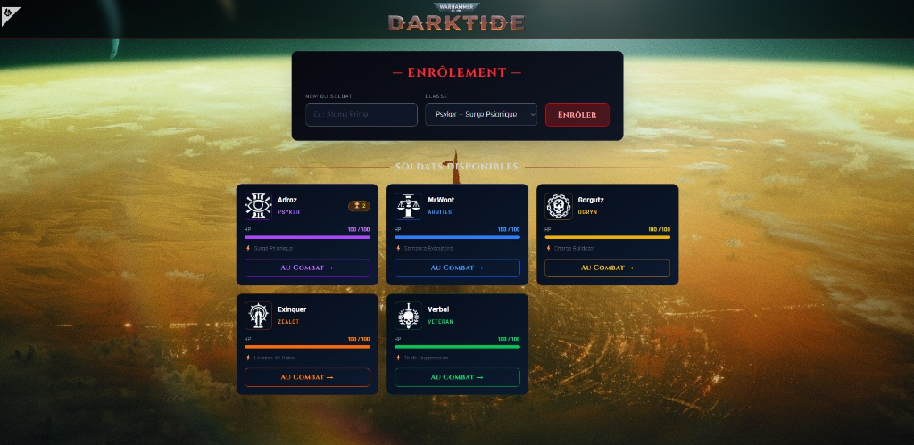

# POO-Combat

Jeu de combat au tour par tour en PHP orienté objet, inspiré de l'univers de *Warhammer 40,000: Darktide*.
On crée un héros en choisissant sa classe, on l'envoie affronter un monstre tiré au hasard, puis le combat se déroule automatiquement et s'affiche tour par tour. Les héros, leurs points de vie et leurs victoires sont enregistrés en base.

> **Projet de formation (Garage4O4).** C'est un TP de programmation orientée objet en PHP, découpé en 2 sprints, dont l'énoncé est conservé dans [`docs/enonce.md`](docs/enonce.md). Je l'ai réalisé seul en prenant des libertés par rapport aux consignes (univers Darktide, 5 classes, énergie et effets de statut), puis retravaillé dans son intégralité : ce README décrit ce que fait réellement le code.



---

## Fonctionnalités

- **Création d'un héros** : nom unique et classe au choix parmi 5 (Psyker, Zealot, Veteran, Ogryn, Arbites).
- **Choix du héros** : seuls les héros encore en vie (PV > 0) peuvent combattre. Ils sont triés par nombre de victoires.
- **Monstre aléatoire** : tiré parmi une quarantaine de monstres répartis en 7 catégories (infanterie, élite, monstruosité, capitaine…). Le monstre est gardé en session entre l'affichage et le lancement du combat.
- **Combat automatique** avec un journal tour par tour :
  - attaque de base propre à chaque classe, avec des coups critiques contre certains types de monstres ;
  - jauge d'énergie (+20 par tour) qui déclenche une attaque spéciale quand elle est suffisante ;
  - effets de statut appliqués par les attaques spéciales : gel, étourdissement, affaiblissement, poison ;
  - faiblesse de classe : certains monstres infligent le double de dégâts à certaines classes de héros.
- **Fin de combat** : statistiques (tours, attaques spéciales, dégâts infligés et reçus), +20 PV pour le héros s'il survit, et victoire comptabilisée.
- **Soldats tombés** : les héros morts sont listés à part et peuvent être supprimés.

---

## Stack technique

| Couche | Technologie |
|--------|-------------|
| Langage | PHP 8 (`declare(strict_types=1)`, POO, sans framework) |
| Base de données | MySQL / MariaDB via PDO (requêtes préparées) |
| Front | HTML, Tailwind CSS (CDN) |
| Environnement | XAMPP / WAMP (Apache + MySQL) |

---

## Choix techniques

- **Séparation des rôles entre classes** :
  - `Hero` et `Monster` portent l'état (PV, énergie, classe) et les règles d'attaque ;
  - `HeroesManager` gère la persistance des héros (création, lecture, mise à jour, suppression) ;
  - `FightsManager` génère les monstres et déroule le combat.
- **Encapsulation** : propriétés privées, accès par getters et setters, validations dans les setters (PV jamais négatifs, classe inconnue remplacée par une classe par défaut).
- **Hydratation** : `HeroesManager::hydrate()` transforme une ligne SQL en objet `Hero`.
- **Autoloading** avec `spl_autoload_register` (`config/autoload.php`).
- **Combat calculé côté serveur** : `FightsManager::fight()` renvoie le journal et les statistiques, la page ne fait que les afficher.

---

## Installation (XAMPP / WAMP)

```bash
# 1. Cloner le dépôt dans le dossier du serveur web (ex. C:\xampp\htdocs)
git clone https://github.com/AxelAlvarez115/POO-Combat.git

# 2. Créer la base `poo-combat` et importer le schéma
mysql -u root -e "CREATE DATABASE \`poo-combat\` CHARACTER SET utf8mb4"
mysql -u root poo-combat < POO-Combat/db/poo-combat.sql
```

Ouvrir ensuite http://localhost/POO-Combat/.

La connexion à la base est définie dans `config/db.php` (par défaut `root` sans mot de passe, la configuration locale de XAMPP).

---

## Structure du projet

```
POO-Combat/
├── index.php                 # Création et choix des héros, soldats tombés
├── fight.php                 # Monstre tiré au sort, combat, résultat
├── classes/
│   ├── basics/               # Hero, Monster
│   └── managers/             # HeroesManager (BDD), FightsManager (combat)
├── config/                   # autoload.php (autoloader + session), db.php (PDO)
├── partials/header.php
├── db/poo-combat.sql         # Schéma de la base
└── assets/img/               # Visuels des héros et des monstres
```

---

## Limites connues

- Les classes de héros sont gérées avec un `switch` dans `Hero`. Une évolution logique serait une classe abstraite et une sous-classe par classe de héros, pour remplacer ces `switch` par du polymorphisme.
- La table `monsters` est créée mais pas encore utilisée : les monstres sont définis dans `FightsManager`.
- `assets/js/hero-hit.js` appelle un endpoint (`process/hit.php`) qui n'existe pas : c'est un reste d'une version précédente.
- Les identifiants de base de données sont écrits dans `config/db.php`, et l'affichage des erreurs PHP est activé (configuration de développement).
- Les visuels et les noms de personnages viennent du jeu *Warhammer 40,000: Darktide* ; ils sont utilisés ici dans un cadre pédagogique.

---

## Mon rôle

Projet de formation réalisé seul. Je l'ai retravaillé dans son intégralité.
